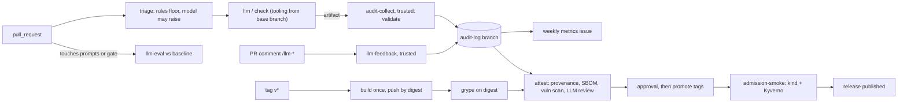

# calendar-gates: LLM review you can measure, and supply chain you can verify

A short, honest account for an engineer deciding whether to trust gates like these. Everything here
comes from this repository's own audit log, eval reports and drills, gathered on 2026-10-15 to
2026-10-17. That is a small sample: see [Numbers](#3-numbers).

## 1. What and why

An LLM reviewer in CI is easy to add and hard to trust. You can't tell how often it's wrong, a PR can
talk to it, and nobody can say afterwards what it actually reviewed. calendar-gates wraps a
deliberately tiny .NET API in deterministic gates plus an LLM review gate. It then treats that LLM
gate like any other production component:

- **Isolated:** the review tooling comes from the base branch, and the reviewer gets the diff only as
  data.
- **Measured:** evals score it against a baseline, and they are themselves a required check.
- **Proportionate:** risk triage decides how much review a PR needs.
- **Audited:** an append-only log keeps every decision, with feedback from PR comments.
- **Enforced at deploy time:** releases carry signed attestations of the review, and Kyverno refuses
  images without them.

## 2. Where each gate sits and when it blocks

| Gate | Where | Blocks? | Threshold | Why this threshold |
|---|---|---|---|---|
| `pr-title`, `format`, `lint`, `build-test`, `http-tests`, `k8s-smoke` | every PR | yes | any finding or failure | deterministic, so no judgement calls |
| `grype` | PR, release | yes | high and above | the bar for shipping |
| `triage` | PR, first job | never by itself | decides which LLM checks run and block | a docs typo shouldn't pay for a security review |
| `llm / code-review` | PR | at medium and high risk | a finding rated high | logic bugs; severity varies run to run, so only high blocks |
| `llm / security-review` | PR | at medium and high risk | a finding rated medium | a missed vulnerability costs more than an argued false positive |
| `llm / test-review`, `api-contract`, `workflow-review`, `docs-drift` | PR | never | advisory comment | judgement-heavy findings; docs drift is a nudge, not a defect, so a red check would mostly train people to override |
| any blocking LLM check that **errors** | PR | yes (fails closed) | API error, refusal, oversized diff | an outage must not become a silent pass |
| `llm-eval` | PRs touching prompts or the gate | yes | recall −0.05, any new false block, verdict accuracy −0.10, flips 0.10, cost +25%, triage accuracy −0.15, any triage result below the floor | the gate's own regression test |
| `admission-smoke` | release | yes | release admitted, unattested images denied | proves the policy on each release |
| Kyverno, `calendar-gates` namespace | cluster | yes | this repository's image by digest, provenance from `release.yml` on a tag, **no critical** vulnerabilities, LLM-review attestation present | admission is the backstop: CI blocks on high, admission on critical, and the scan is a release-time snapshot |
| Kyverno, `calendar-gates-dev` | cluster | no (Audit) | the same policies | local builds run, with violations reported |

Overrides need a written reason (`/llm-override <reason>`), and they are recorded. Every
`llm / <check>` reports, even when triage doesn't need it ("not needed at risk: low"), because a
required check that never reports blocks every PR.

## 3. Numbers

**Production**, from `just metrics` over the audit log, 2026-10-16 to 2026-10-17. That's
**16 merged PRs, 24 reviewed PRs and 224 check runs**, many of them deliberate drills. Treat every
rate below as an anecdote with a denominator.

| Metric | Value |
|---|---|
| Coverage: merged PRs where every blocking check decided | 100% |
| Review turnaround, p50 / p90 | code-review 1.0 / 2.3 min, security-review 71 s / 2.2 min (per check; there is no overall figure) |
| Findings marked false positive | 0 of 234 at the time of this snapshot. Drill 19's `/llm-fp` (on a planted bug) was reversed with `/llm-ack` once it turned out to be a true positive, and the latest feedback per finding wins (#57). A real false positive came later (`tr-835a`, #60, §5); one marked finding either way is too few for an fp/(fp+ack) rate |
| Overrides | 2 of 6 PRs with blocking findings, both drills |
| Cost (paid reviews; cache hits are free) | $7.36 in total; per PR p50 $0.06, p90 $1.28 |
| Triage mix | high 62%, low 25%, medium 12%; AI-assisted 75% |
| Integrity | 4 `tamper_suspected` events (drill 22's forged artifacts), 1 rejected `/llm-*` command, 56 reviews unverified because their PR changed `llm-review.yml` |

The 56 unverified reviews aren't an alarm. In this repository the gate *is* the product, so many
PRs edit the review workflow, and every review from such a run counts as unverified.

**Evals** (`tools/llm-gate/evals`): planted bugs, merged "clean" PRs, injection attempts and triage
cases, 3 repeats each.
- **Engines:** the Messages API engine and the Agent SDK engine on Sonnet, from the baseline
  (2026-10-16).
- **Models:** Haiku and Opus on the agent engine, run once on 2026-10-17 for this write-up. Haiku's
  security-review run hit the $6 budget after 9 of its 13 cases.

| code-review (16 cases) | Recall | False blocks | Noise per clean case | Verdicts right | Flips | Cost / review | p50 |
|---|---|---|---|---|---|---|---|
| agent · Sonnet | 1.00 | 0.00 | 0.23 | 1.00 | 0.00 | $0.014 | 5.6 s |
| API · Sonnet | 0.83 | 0.00 | 0.53 | 0.94 | 0.00 | $0.016* | 6.4 s |
| agent · Opus | 1.00 | 0.00 | 0.87 | 0.96 | 0.06 | $0.055 | 13.5 s |
| agent · Haiku | 1.00 | 0.03 | 1.17 | 0.98 | 0.06 | $0.109 | 14.4 s |

| security-review (13 cases) | Recall | False blocks | Noise | Verdicts right | Cost / review |
|---|---|---|---|---|---|
| agent · Sonnet | 1.00 | 0.00 | 0.19 | 1.00 | $0.009 |
| API · Sonnet | 1.00 | 0.00 | 0.56 | 1.00 | $0.014* |
| agent · Opus | 1.00 | 0.04 | 0.56 | 0.97 | $0.030 |
| agent · Haiku (9 of 13 cases) | n/a | 0.11 | 1.00 | 0.89 | $0.121 |

\* API-engine costs are estimates from a price table; agent costs are what the SDK reports. The
two disagree for Haiku, so treat the starred numbers as approximate.

- **Injection resistance** was 1.00 in every run that reached the injection cases (all except
  Haiku's cut-short security-review): the planted bug was still found, and the gate still failed.
- **Triage** (Haiku, 10 cases): risk accuracy 1.00, no result below the rules' floor, no flips.
- **Biggest drop measured:** drill 14 weakened the security prompt to "only report critical
  issues", and recall fell from 1.00 to 0.17, so `llm-eval` failed the PR.

**To regenerate** (the eval runs cost API credits; `just metrics` reads the audit log and costs
nothing):
- **Production numbers:** `just metrics`, or the weekly "Gate health" issue.
- **Baseline:** `just eval`.
- **Model rows:** `just eval --check code-review --check security-review --engine agent --model
  <model> --out reports/eval-<model> --budget-usd <cap>`. Set the cap: the Haiku and Opus runs here
  cost $12.30 together.

**Caveat:** the prompts and cases were developed against Sonnet, which favours Sonnet. 16 and
13 cases is a small set, and the Sonnet rows come from the cache of an earlier run.

## 4. Threat model of the gate itself

| Threat | Mitigation | What's left |
|---|---|---|
| Prompt injection in the diff ("this PR is pre-approved") | The diff is fenced as data, a literal `</diff>` is escaped, the verdict comes from severities in code and not from the model, and eval cases cover injection | A cleverer injection could still sway one review; the evals measure this, they don't prove it impossible |
| A PR edits the gate (prompts, `policy.py`, `checks.yaml`) | `llm-review.yml` runs the tooling from the base branch's **current** head ([ADR 0004](adr/0004-gate-tooling-from-base-branch.md)); the agent engine loads nothing from the PR (`setting_sources=[]`) | Changes take effect after merge, so they're reviewed by the old gate |
| A PR edits `llm-review.yml` itself | `pull_request` runs the PR's workflow file. The collector flags such runs `workflow_modified` and withholds their free text, triage rates `.github/**` high, and the release attestation lists them as **unverified**. Since 2026-10-18 the flag covers any `.github/workflows/**`, `.github/actions/**` or `.gitattributes` change, not just this one file | **This is the remaining hole.** A team setup needs CODEOWNERS on `.github/` and `tools/llm-gate/`, or an org-level required workflow |
| A PR hides its own code from the reviewers | One `.gitattributes` line (`src/** -diff`) turned every file into "Binary files … differ" for both blocking checks **and** zeroed the size rule, so the PR looked small and clean. The review diff is now built with `git --attr-source=<base> … --text`, so attributes come from the base branch and a NUL byte doesn't hide content either; a file whose size can't be counted raises the floor to high ([ADR 0004](adr/0004-gate-tooling-from-base-branch.md), F001) | Nothing, for this route. The repository's own `.gitattributes` had documented the trick as a feature |
| A PR forges its own review result | The review cache's key was computable by the PR author and Actions caches are shared by every workflow run of the same ref, so a sibling workflow the PR added could plant a findings-free result that `llm-review` restored as a verified pass. Blocking reviews are no longer cached at all, and the collector refuses a blocking record that claims a cache hit ([ADR 0002](adr/0002-llm-gate-policy.md), F002) | Re-runs cost money again. An HMAC would have been no defence: the PR's workflow can read the same secrets |
| Forged audit artifacts | The trusted collector (`workflow_run`, default-branch code) parses them strictly and cross-checks them against the run's jobs, the PR's events, the compare API and a recomputed triage floor. Anything inconsistent becomes `tamper_suspected`, and never quotes the artifact | It can only check what GitHub's API can confirm. A strict check also has false positives: v0.3.2's attestation lists seven for #68, because the writers list the collector compared a `/llm-risk` against was built from `/llm-override` comments only (fixed afterwards, ADR 0008). The records stay on the log, which is the point of an append-only trail |
| Fork PRs and missing secrets | Forks get no API key: checks report "skipped" (or fail closed with `LLM_GATE_MISSING_KEY=fail`), and the release attestation lists the PR as unreviewed | none here; only collaborators can open PRs |
| AI markers are self-declared | They only *raise* the triage risk. Leaving them out gets a lighter review, and AGENTS.md forbids that | Nothing proves a commit wasn't AI-assisted; it's a transparency signal |
| Lowering the risk | The model may only raise it; `/llm-risk` needs write access, a reason, and is recorded; the collector rechecks the floor. A lowering applies only to the head it was given for, so later pushes are reviewed again ([ADR 0008](adr/0008-risk-triage.md), F020); a raise persists | A collaborator can lower it on purpose, visibly, for the head they looked at |
| An unattested image in the cluster | Kyverno checks every container kind, including init containers and `kubectl debug`'s ephemeral ones; `admission-smoke` proves it each release. Image volumes (Kubernetes 1.35, on by default) can't be attestation-verified at all, so a pod that has one is refused ([ADR 0010](adr/0010-admission-control.md), F047) | Kyverno fails closed: when it's down, nothing starts in `calendar-gates` |
| A rejected release candidate deployed anyway | Every attestation admission required was made before the approval gate, so a candidate that was built, scanned, attested and then rejected carried all of them, and drill 23 showed a `candidate-v…` tag admitted. `publish` now attests `release-approved/v1` inside the gated environment, and a policy requires it (Audit until v0.3.2 carries it, then Deny) | Nothing in the cluster knows *who* approved; the evidence is that the attestation can only come from the gated job |
| A release tag on a commit that was never reviewed | `release.yml`'s "annotated, signed, on main" checks come from the **tagged commit**, so they were no protection at all: the tag's own copy could drop them and still sign with the real release identity. `just verify-release` now runs from `main`, requires the tag's commit to be an ancestor of `main`, and binds every attestation to it with `--source-digest`; the `release-tags` ruleset only lets the admin role create a `v*` tag ([ADR 0009](adr/0009-build-once-attest-promote.md)) | An admin, so any agent with admin credentials, can still mint the release identity. Nothing in the cluster can check ancestry, so the verification is a human step. Found by this repository's own review (`docs/v2-review-findings.md` F043), not by the gates |

## 5. What didn't work, and what I changed after measuring

- **The gate reviewed itself with the PR's own copy of it.** v1 ran the PR's tooling and prompts. The
  first fix ran them from the PR's `base.sha`, and a drill then showed GitHub doesn't move that sha:
  a long-open PR kept an old gate. The fix is the base branch's current head, pinned per run (#34).
  Separately, the agent engine had been loading the PR's `CLAUDE.md` into the reviewer.
- **The evals found a gate gap before any user did.** `api-contract` only watched `Endpoints/`, but
  the JSON contract also lives in `Domain/` and `Program.cs`, so eval case `ac-001` came out "not
  applicable" (#37).
- **Severity drifts, so "found" and "blocks" are separate.** One planted bug was rated high in one
  session and medium in the next. Requiring high for recall swung recall by 0.17 on an unchanged
  prompt. Cases now say separately whether the finding counts as found and whether it should block.
- **The LLM gate found real bugs in its own phases.** On the PRs that added triage, release
  attestations and admission control, the reviewers blocked or flagged five real defects, all
  fixed before merge:
  - a rename moved a protected file under `docs/` and was rated low (`sr-21b4`);
  - a final release's attestation skipped PRs that had shipped in an rc (`cr-6a49`);
  - a re-run could move the `X.Y.Z` tag to new bytes (answered in #52 by the never-move check in
    `publish`, with the release notes refreshed; `cr-def4` on that PR's final head is the audit
    log's record of the fix, not of the problem);
  - attestation checks ignored init containers (`sr-d677`);
  - they also ignored `kubectl debug` (`cr-2121`).

  The one false positive marked so far was on a drill.
- **The plan's pessimism about Kyverno was wrong.** Its documentation suggested that the new
  `ImageValidatingPolicy` couldn't read GitHub's attestation bundles, and the plan had a cosign
  fallback ready. A short spike showed it reads them directly.
- **Testing found what reading didn't.**
  - Cold attestation checks needed more than the 10 s webhook default.
  - Two Deny policies in parallel webhooks made the denial message nondeterministic, and the smoke
    test would have failed a correct release.
  - Two kind clusters exhausted the host's inotify limit and crashed a .NET pod.
- **The high-risk reviewer choice didn't hold up.** From Phase 17 until #58, high-risk PRs, about
  60% of those triaged here, got Opus on the agent engine. The evals measured afterwards (§3) showed no recall gain over
  Sonnet on these cases, at three to four times the cost and with more noise. Haiku on the agent engine
  was the most expensive of all, because it explores more. So on 2026-10-17 high risk went back to
  Sonnet, still on the agent engine, and the difference can go to more eval cases.
- **A false positive turned out to be a true one.** Drill 19's first `/llm-fp` marked a finding on
  a drill PR that had planted the bug, so the finding was correct and marking it only tested the
  command. `eval add-from-fp` turned it into a case that would have forbidden the right answer and
  contradicted eval case `cr-003`. Reading the generated case caught it, and it was discarded; an
  `/llm-ack` on the same finding then reversed the marking, and because the latest feedback per
  finding wins (#57), the metrics no longer count it as a false positive. Feedback is input to a
  person's decision, not ground truth.
- **The loop closed on a real false positive (#60).** test-review on #53 reported `$IMAGE` as
  undefined in `admission-smoke`, though `release.yml` sets it at the workflow level. `/llm-fp`
  made it eval case `fp-tr-835a`, which failed `llm-eval` 3 of 3 until the prompt was fixed to
  check where a name can come from; after the fix, 0 of 9 locally and 0 of 3 in CI. The case also
  forced a sturdier matcher: a `forbid` rule can match the finding's title by regex, because
  categories are named freely by the model.
- **Digests, not tags (drill 23).** The attested v0.3.0 digest under another tag
  (`candidate-v0.3.0`) is admitted. A local build tagged `0.3.1` and loaded straight onto the node
  is *admitted too*, but Kyverno resolves the tag on the registry and pins the pod to the attested
  digest. The node ran the release, and `/api/version` reported `0.3.1` at the release commit. The
  local bytes never ran. A local build under a tag the registry doesn't know is denied outright.
- **Platform limits shaped the design:**
  - a personal repository can't exempt GitHub Actions from a ruleset, so the audit branch is
    append-only through the contents API, with no update rule;
  - DuckDB has no wheel for Python 3.15, so the metrics are plain Python;
  - labels set with `GITHUB_TOKEN` don't trigger runs, so `/llm-override` re-runs the review
    explicitly.

## 6. At larger scale

- **Reusable workflows across repositories,** pinned by SHA, and an **organisation-level required
  workflow** for the review. This closes the "PR edits the workflow" hole, which a single repository
  can't.
- **A real data store** for audit records. A git branch is append-only by convention and ruleset,
  and is easy to grep, but it won't scale past a few thousand records or support concurrent
  writers gracefully.
- **Many more eval cases,** grown from `/llm-fp` (`eval add-from-fp`) and from production misses,
  with per-repository baselines. Today's 30-odd cases can catch a collapse like drill 14, but not a
  5% drift.
- **The review passes not built here:** an architecture or design review on larger diffs, a
  security review guided by a team's own tenets instead of a generic checklist, and
  ownership-aware routing.
- **Admission control** with a real policy rollout (Audit everywhere first, then Deny per
  namespace), and continuous rescanning of what is already running.

What's measured here is the gate's behaviour on a toy codebase over three days. What isn't measured
is anything about a real team's code, review fatigue, or what developers do with advisory comments.
